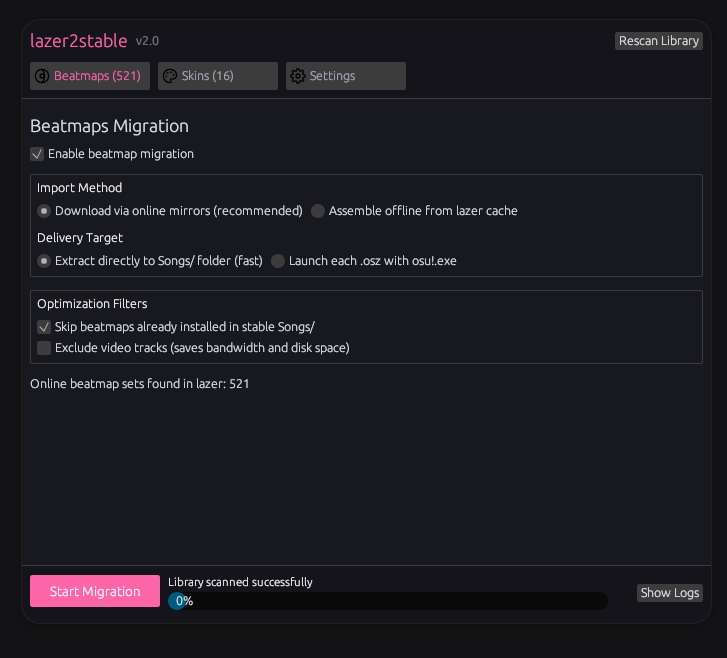

<div align="center">

# lazer2stable

**Move your beatmaps and custom skins from osu!lazer to osu!stable in a few clicks.**

[](https://github.com/RiaLnN/lazer2stable/releases/latest)
[](https://github.com/RiaLnN/lazer2stable/releases)
[](LICENSE)




</div>

---

## What does it do?

If you play on osu!lazer and want your stuff in osu!stable, lazer2stable does the copying for you:

- **Beatmaps**: every beatmap set from your lazer library ends up in stable's `Songs` folder.
- **Skins**: every custom skin is rebuilt from lazer's storage and installed into stable's `Skins` folder (also exported as `.osk` files).

Your lazer data is **never modified**. The tool only reads from it.

---

## Download

1. Open the [**Releases page**](https://github.com/RiaLnN/lazer2stable/releases/latest).
2. Download the archive for your system:

| System | File |
| --- | --- |
| Windows (64-bit) | `lazer2stable-vX.Y.Z-windows-x64.zip` |
| Linux (64-bit) | `lazer2stable-vX.Y.Z-linux-x64.tar.gz` |

3. Extract it anywhere. **Keep all files together**, especially the `bridge` folder, the app needs it.

You do **not** need to install .NET, Rust or anything else.

> **Windows note:** SmartScreen may warn about an unrecognized app because the executable is not code-signed. Click **More info → Run anyway** if you downloaded it from this repository's Releases page.

---

## Quick start (GUI)

1. **Close osu!lazer.** This makes sure its database is not locked.
2. Run `lazer2stable-gui` (`lazer2stable-gui.exe` on Windows).
3. On the **Beatmaps** tab, choose how to get your maps (see [Choosing a mode](#choosing-a-mode)).
4. On the **Skins** tab, tick the skins you want, or use *Select All*.
5. Check the **Settings** tab. Folders are detected automatically, change them only if something looks wrong.
6. Press **Start Migration** and wait for the progress bar to finish.
7. Start (or restart) osu!stable. Your maps and skins are there.

Need details? Open the log viewer at the bottom of the window.

---

## Choosing a mode

| I want to... | Use |
| --- | --- |
| Get the newest versions of maps, with a small risk of missing ones | **Network** (default): downloads `.osz` files from mirrors (catboy, nerinyan, osudirect) |
| Work offline or keep exactly what I have in lazer | **Local**: builds `.osz` files from lazer's own storage, no internet needed |
| Maps placed straight into `Songs` | Delivery **extract** (default) |
| Let osu!stable import the maps itself | Delivery **open** |
| Save bandwidth and disk space | Enable **no video** |

Maps already present in stable are skipped automatically, so you can safely run the tool again.

---

## FAQ and troubleshooting

**Is it safe? Will it break my lazer or stable?**
lazer's `client.realm` is opened strictly read-only. Archives are extracted with path-traversal (Zip Slip) protection. Maps already in stable are skipped, not overwritten.

**The tool cannot find my osu! folders.**
Open the **Settings** tab (or pass `--lazer-dir`, `--stable-dir` in the CLI) and select them manually. On Windows the defaults are usually `%AppData%\osu` (lazer) and `%LocalAppData%\osu!` (stable).

**It says the database is locked or fails to read it.**
Close osu!lazer completely, including the system tray, and try again.

**Downloads are slow or I see "429 Too Many Requests".**
Mirrors rate-limit heavy use. The tool waits and retries automatically. Lowering *concurrency* in Settings can help.

**Some maps did not download.**
A mirror may not have them. Run the migration again, or switch to **Local** mode.

**My new maps are not showing in stable.**
Restart osu!stable so it rescans the `Songs` folder.

**The Linux GUI does not start.**
Make sure GTK 3 and the usual X11/Wayland libraries are installed (for example `libgtk-3-0` on Debian/Ubuntu).

**Does it work on macOS?**
Not at the moment. Releases are provided for Windows and Linux.

---

## Command-line usage

Prefer a terminal? Everything the GUI does is available in the CLI:

```bash
# Preview what would be migrated, changes nothing
lazer2stable-cli --dry-run

# Run the full migration with auto-detected folders
lazer2stable-cli

# Skins only
lazer2stable-cli --skins-only

# First 20 beatmaps, without videos
lazer2stable-cli --limit 20 --no-video

# Custom folders and concurrency
lazer2stable-cli \
  --realm "C:\Users\<user>\AppData\Roaming\osu\client.realm" \
  --stable-dir "C:\Users\<user>\AppData\Local\osu!" \
  --concurrency 6
```

<details>
<summary><b>All CLI options</b></summary>

```text
Options:
  -c, --config <CONFIG>            Path to config file [default: config.toml]
      --realm <REALM>              Path to osu!lazer client.realm database file
      --lazer-dir <LAZER_DIR>      Path to osu!lazer root directory (containing files/ and client.realm)
      --stable-dir <STABLE_DIR>    Path to osu!stable directory
      --songs-dir <SONGS_DIR>      Path to osu!stable Songs folder
      --skins-dir <SKINS_DIR>      Path to osu!stable Skins folder
      --mode <MODE>                Delivery mode for beatmaps: "extract" or "open"
      --source-mode <SOURCE_MODE>  Source mode for beatmaps: "network" or "local"
      --no-video                   Download beatmaps without video tracks
      --no-skip-installed          Do not skip beatmaps already found in stable Songs/
      --concurrency <CONCURRENCY>  Number of concurrent network downloads
      --skins-only                 Migrate only custom skins
      --beatmaps-only              Migrate only beatmap sets
      --limit <LIMIT>              Limit the number of beatmaps to process
      --dry-run                    Inspect found items without making changes
  -h, --help                       Print help
  -V, --version                    Print version
```

</details>

---

## Configuration

Copy `config.example.toml` to `config.toml` (next to the executable) to change defaults:

```toml
[paths]
cache_dir = "cache"

[beatmaps]
enabled = true
source_mode = "network"       # "network" or "local"
delivery_mode = "extract"     # "extract" or "open"
no_video = false
skip_existing = true
concurrency = 4
sources = ["catboy", "nerinyan", "osudirect"]

[skins]
enabled = true
export_as_osk = true
unpack_to_stable = true
```

CLI flags always override values from the config file.

---

## For developers

<details>
<summary><b>How it works</b></summary>

```
client.realm ──(realm-bridge, C#)──> metadata ──(Rust core)──┬──> .osz / Songs/ (beatmaps)
                                                               └──> .osk / Skins/ (skins)
```

A small C# bridge reads lazer's Realm database and dumps metadata as JSON. The Rust core then downloads or assembles beatmap archives and rebuilds skins from lazer's content-addressed `files/` storage.

```
lazer_to_stable/
├── bridge/                     # C# dynamic Realm bridge (.NET 8, Realm 20.1.0)
├── crates/
│   ├── core/                   # shared library (bridge, config, detector, downloader, beatmaps, skins)
│   ├── cli/                    # command-line executable
│   └── gui/                    # egui desktop application
├── packaging/                  # files bundled into release archives
├── config.example.toml
└── README.md
```

</details>

<details>
<summary><b>Building from source</b></summary>

Requirements: [Rust](https://rustup.rs/) (1.80+ or latest stable) and [.NET SDK 8.0+](https://dotnet.microsoft.com/download).

```bash
# 1. Build the Realm bridge
dotnet build bridge/BeatmapDump.csproj -c Release

# 2. Build the Rust workspace (CLI and GUI)
cargo build --release
```

Outputs:

- `target/release/lazer2stable-gui`
- `target/release/lazer2stable-cli`
- `bridge/bin/Release/net8.0/realm-bridge.dll`

Run directly from source:

```bash
cargo run --release -p lazer2stable-gui
cargo run --release -p lazer2stable-cli -- --dry-run
```

On Linux you also need the GUI development packages: `libxcb-render0-dev libxcb-shape0-dev libxcb-xfixes0-dev libxkbcommon-dev libssl-dev libgtk-3-dev`.

</details>

Releases are built automatically by GitHub Actions when a `v*` tag is pushed.

---

## Contributing

Bug reports and pull requests are welcome. When reporting a problem, please include your OS, the app version, and the log from the GUI's log viewer (or the CLI output).

---

## License

[MIT](LICENSE)
